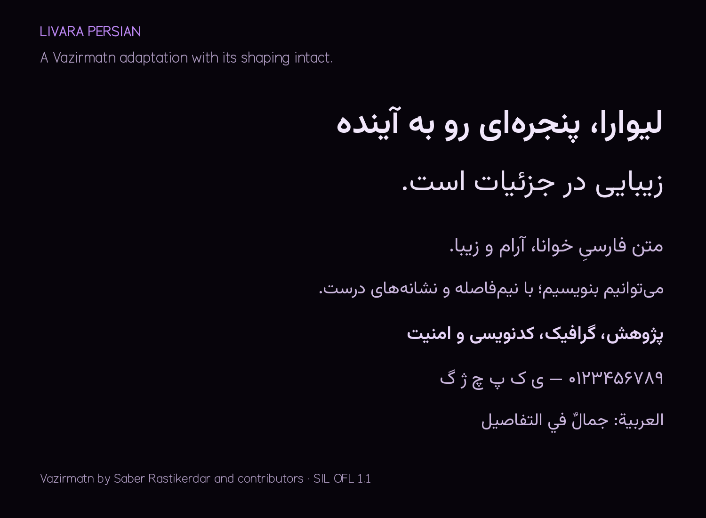

# Livara OS

Livara is a **64-bit x86-64 (`amd64`)** live Linux desktop for Intel and AMD processors, including Intel Core Ultra 7. It combines an Ubuntu 24.04 GNOME base, original Livara glass styling, Livara applications, security tools, and a separate Kali workbench. The supplied purple glass **L** is the OS identity; Browser and Code have their own derivatives.

[Hosted builds](https://github.com/Livara-Dev/Livara-OS/actions) · [ISO releases](https://github.com/Livara-Dev/Livara-OS/releases) · [Dependency policy](docs/dependency-updates.md)

ISO publication requires compiled application runtime checks and BIOS/UEFI QEMU boot tests. Both application engines have compiled from source and passed their runtime checks. ISO assembly and boot qualification are in progress; no completed ISO release is claimed until those jobs succeed.

**To build locally, extract the whole source ZIP and run `Build-Livara.bat`.** Start Docker Desktop in **Linux amd64 container mode** first. The BAT compiles the customized applications and builds an ISO on your computer. The lightweight source ZIP excludes ISO images, prebuilt application bundles and build caches. Published ISO files belong in GitHub Releases, with verified parts/joiners if larger than the release-file limit.

Full source compilation is substantial: allocate **16GiB RAM to Docker Desktop** (24GiB recommended), at least **100GiB free in its Linux disk** (150GiB recommended), and allow many GB of downloads and a long build. Core Ultra 7 identifies the CPU/architecture; it does not establish your machine's RAM or disk capacity. See [Windows instructions](docs/windows-build.md).

```bat
Build-Livara.bat
```

A smaller source/recipe/package check, without compiling application engines or creating an ISO:

```bat
Build-Livara.bat -Check
```

The full build writes `dist/livara-os-0.1.0-amd64.iso`, its checksum, and a package inventory. It compiles real application source; it does not silently replace a failed application build with the retired native editor or a stock upstream binary.

## Livara applications

| Application | Implemented behavior |
| --- | --- |
| **Livara Code** | A source fork of VS Code's MIT-licensed codebase, with compiled Livara workbench styling, own icon/identity, AMOLED black/purple theme, local fonts, file icons, welcome hub, Open VSX extensions, integrated terminal and twelve additional productivity commands. [Details](docs/code-editor.md). |
| **Livara Browser** | A source fork of Zen/Gecko with Livara branding, glass chrome, spaces/vertical tabs, appearance controls, tab search, reader action, and an offline dashboard with shortcuts, notes, clock and focus timer. [Details](docs/browser.md). |
| **Tor mode** | Launches the **official Tor Browser** as a separate application/profile, retaining its security features, bridge support, bundled fonts and canonical appearance. The build verifies the official archive's signature and hash. Livara's ordinary browser does not become Tor Browser by using a proxy. [Tor mode](docs/tor-mode.md). |
| **Livara Settings** | A redesigned, searchable studio with **94 preferences across eight sections**, live previews, saved looks, wallpapers, fonts and scoped resets, plus an **App icons** manager for default and installed app launchers. [Customization](docs/customization.md) · [App icons](docs/app-icons.md). Hardware panels still come from GNOME. |
| **Livara Task Manager** | Real CPU/memory/network graphs, searchable processes, details and confirmed identity-checked process controls. |
| **Livara Studio** | A redesigned dashboard, **30 local tools**, favorites, recent tools, split input/result workspaces, a private Notebook and a Focus room, with its own appearance controls. [Inventory](docs/studio-features.md). |
| **Livara Terminal** | Dedicated palette/profile, Livara Mono, purple prompt/banner, and user customization preserved after initialization. |
| **Livara Chat** | `https://chat.livara.org` as a dedicated native app, installed by default. It needs internet and the website's services; no chat backend is bundled. |
| **Livara Graphics** | Actual CPU, Intel/NVIDIA device, driver, kernel, session, Secure Boot and PRIME observations; explicit repair guidance. |
| **Livara Essentials** | Theme Studio with saved/imported looks, profiles, desktop layouts, drawn window zones, opt-in clipboard history, permission controls, Security Lab and offline help; integrates real preview, recording, recovery, phone pairing, hardware, account, update and installer tools. [Feature guide](docs/essentials.md). |
| **Livara Palette** | Super+Alt+Space search for apps, local files, settings and Studio tools; keyboard navigation and bounded local scanning. |
| **Livara Center** | System observations, app hub, security toolbox, case workspaces, Shield and file verification. |

The old GTK editor and WebKit default-browser prototype have been replaced. Chat remains a small native WebKit application. Normal user-facing product branding in the application forks is Livara; original licenses, copyright notices, extension APIs, and technical compatibility identifiers remain intact. Installing third-party extensions can display their authors' own branding.

Only Center starts automatically as a Livara app. System services follow their package defaults. Essentials and the palette start on request. Other applications start on request. The Code fork uses Electron and the Browser fork uses Gecko, so their resource requirements differ from the retired native prototypes. Their pinned source versions have no Livara update service; review new upstream releases and rebuild for security updates. The official Tor Browser keeps its own signed updater in its private user copy.

Actual application captures and their limits are listed in the [screenshot gallery notes](docs/screenshots/README.md). Run `python3 scripts/package-screenshots.py` to create an offline HTML gallery and a ZIP of the original PNGs from the included captures.

## More ways to make Livara yours

Open **Settings → Feature hub → Livara Essentials** for the new AMOLED black/purple feature pages. Theme previews and settings write to real desktop services; shortcuts require the Livara GNOME extension. Quick Look uses Sushi, recording uses OBS, snapshots use Timeshift, and phone sharing uses KDE Connect. These integrations need their own configuration where indicated. See [all 17 feature areas](docs/essentials.md).

The source includes a branded Calamares installer with optional LUKS2 encryption and persistent local accounts. Its configuration and native welcome UI have been checked, but a complete encrypted disk installation/reboot is **not yet qualified**. [Installation limits](docs/installation.md).

## Beautiful, editable multilingual fonts

**Livara Sans** and **Livara Mono** are original designs. **Livara Persian** is a renamed, attributed derivative of open-source **Vazirmatn**, retaining Persian/Arabic contextual shaping, ligatures, marks and ZWNJ behavior. All have Regular and SemiBold faces. Editable UFO/GLIF, TTX, SVG, model and original licensed SFD sources are included. FontForge is included in the OS; Settings can open an editable copy of the Latin design.

The image installs Noto families for broad Arabic, Hebrew, Indic, Cyrillic, Greek, CJK and other script coverage, plus emoji. Fonts load as needed; the source ZIP does not bundle the large Noto package collection. This is a font fallback system, not a claim that one font covers every language or Unicode character. [Font editing and coverage](docs/fonts.md).



The normal Browser and Code use the Livara multilingual font stack. The official Tor Browser retains its own fonts and renderer configuration to preserve its fingerprinting defenses.

## Glass and customization

Livara Glass uses real GNOME background blur on selected shell surfaces, cached reflective highlights, rounded surfaces and finite animations. Discovery responds to desktop changes; hidden surfaces, Overview and the lock screen release effects. **Efficient rendering** removes blur and transitions; **Full Livara Glass** restores moderate blur and motion. Reduced-motion preferences are respected.

Settings organizes Look, Windows, Dock, Type, Spaces, Focus, Input and Display into searchable sections. Save and rename your own looks, choose a local wallpaper, preview fonts and window controls, or reset one section. Mouse/touchpad, keyboard repeat and Night Light controls use the desktop's real settings; unavailable controls stay disabled. Tweaks, Extension Manager and dconf Editor provide deeper controls. This is Livara's Linux implementation inspired by liquid glass; Apple's proprietary optical renderer and pixel-identical iOS behavior are not implemented. [Architecture](docs/architecture.md).

Livara also adds macOS-style red/yellow/green window controls. Settings customizes their side, size, colors and symbols. Livara's native apps let the green button enter fullscreen or maximize; F11 toggles fullscreen, and Shift+green maximizes/restores. Other applications can retain their own window actions and decoration rules.

Window opening and closing have configurable Zoom, Lift, Fade and Off styles, with adjustable duration. These are finite compositor animations for ordinary windows. They respect reduced motion and Efficient rendering; they are Livara effects inspired by macOS, rather than Apple's window-server implementation. [Window effects](docs/window-effects.md).

## Graphics and security workbench

The build includes Ubuntu's HWE kernel and matching precompiled **NVIDIA 580 open kernel modules/userspace**, targeting RTX 20/30/40/50 series, alongside Mesa for Intel/AMD. No physical RTX card was tested here; display, suspend, hybrid laptops, games and CUDA workloads need qualification on the actual hardware. [Graphics details](docs/graphics.md).

Native tools include Nmap, Wireshark, tcpdump, OpenSSL, Netcat, Lynis, ClamAV, YARA, Hashdeep, Sleuth Kit, ExifTool, GnuPG, Cryptsetup, Strace, Lsof, MTR and ShellCheck. ClamAV needs current definitions. Shield reads local settings; Verify streams SHA-256; Cases records unsigned hash inventories of private evidence workspaces.

The locally built image bundles **Kali core for offline first setup**. Category profiles and the built-in **Download all Kali tools** option download on demand. The full option requests Kali's `kali-linux-everything` metapackage with recommended packages; it is not preinstalled offline or fully runtime-qualified here. Use a mounted persistent Linux disk and substantial free space; 100GB is a starting budget for the full catalog.

```sh
livara toolbox setup
livara toolbox run -- nmap --version
livara toolbox setup --profile web
livara toolbox run --profile web -- sqlmap --version

livara toolbox storage /media/livara/YOUR_DISK/Livara-Toolbox
livara toolbox setup --profile full
livara toolbox run --profile full -- bash
```

Ubuntu and Kali repositories stay separate. Kali runs under rootless Podman with a selected workspace. Hardware/privilege-dependent tools need an appropriate host workflow or VM; installing every package does not enable every feature in a restricted container.

## Build on Linux

Use a Linux amd64 Docker engine. For source checks, install Python3, FontTools, Node24.18+, Make, dpkg tools, GnuPG/GPGv and HarfBuzz CLI. Full application build dependencies run in their Docker images.

```sh
make check
make deb
make kali
make iso
```

`make iso` builds the application forks, prepares the signed official Tor Browser, and then creates the live image. `make apps` builds just the two customized applications; `make fonts` recompiles editable font sources; `make source` creates the lightweight source ZIP. See [validation](docs/validation.md) for exact qualification limits.

## Preview limits and licenses

This is an experimental live preview with a configured Calamares installer whose encrypted installation/reboot path remains unqualified. Live-session persistence is not configured by a wizard. Save work to a mounted disk before shutdown. The live session automatically signs in as `livara` with passwordless sudo. The GRUB chain is unsigned; this preview requires Secure Boot disabled.

Native apps and the compositor have earlier isolated-session qualification records. Current hosted application builds and ISO boot tests are tracked in Actions; only a successful publishing run establishes that its particular ISO passed the documented VM checks. Physical hardware, Secure Boot, encrypted installation and recovery remain separate qualification work. Start with a VM before using physical media.

Original OS tooling is GPL-3.0-or-later. Code-fork modifications use MIT. Browser upstream files retain MPL2.0; new Livara browser sources use GPL-3.0-or-later as marked. Fonts use SIL OFL1.1, and other upstream components retain their own licenses. NVIDIA userspace/firmware have NVIDIA licenses. The supplied mark retains its original rights. [Artwork](artwork/README.md) · [Upstreams](docs/upstreams.md).
