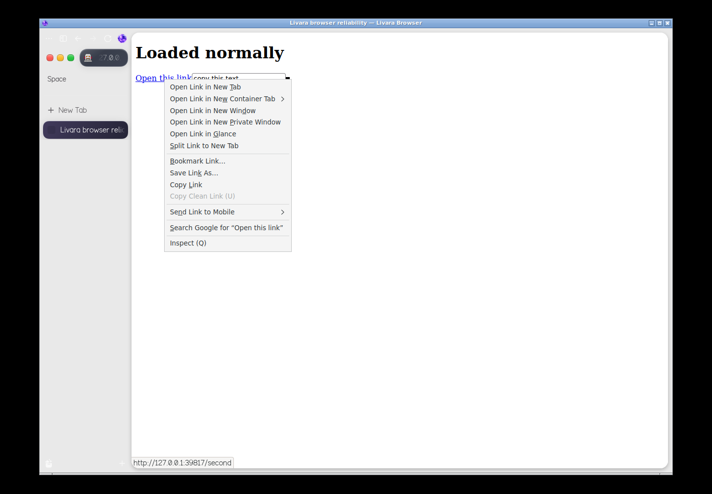

# Desktop update 0.1.4 — browser reliability and automatic boot

The compiled browser omitted Zen's English Fluent resources, while its browser
window still requested them. That prevented the shared localization bundle from
resolving: right-click menus opened without labels, settings pages were incomplete
and even the window title could be blank. The update restores all fourteen pinned
Zen localization files and complete Livara branding terms. Their original commit
and hashes are recorded in `forks/browser/locales/origins.json`; MPL notices and
message IDs are preserved. Fresh source builds and installed updates now use the
same resource planner, so a future build cannot silently omit this repair.

The browser's native Wayland class is `livara-browser`. Its desktop entry now
matches that class, which keeps GNOME from showing a generic or unrelated app
icon. The native test explicitly launches the browser with inherited Settings
launch metadata and opens `about:preferences`; GNOME still identifies it as
`org.livara.Browser.desktop` with `org.livara.Browser` artwork.

Confirmed appearance changes are flushed to the browser's preference file.
Selected dark/light appearance also wins over Zen's startup color scheme while
forced-color accessibility remains available. Normal restored windows are fitted
to the current monitor's scaled work area; maximized/fullscreen geometry remains
under the compositor's control. Valid existing window sizes are preserved.

## Actual package qualification

The harness unpacks the new desktop DEB, installs the existing source-compiled
browser candidate and invokes the updater shipped in that DEB. It verifies that
the native executable and `libxul.so` hashes do not change, and that applying the
update twice is harmless. It then tests:

- Loopback web-page navigation, JavaScript, canvas and persistent site storage.
- A real pointer right-click, visible menu text and Open Link in New Tab.
- Rendered labels on the actual `about:preferences` page.
- Confirmed appearance controls and their saved values after a complete browser restart.
- The actual New Tab command, dashboard startup and notes across restart.
- A profile moved from a 1440×1000 X11 screen to 1280×720, retaining preferences and fitting its window.
- A real GNOME 46 Wayland window, desktop icon matching and monitor work-area bounds.

The browser sandbox stays enabled. These are software-rendered native application
tests, rather than physical monitor/EDID, GPU-driver or multimonitor certification.
[Native package results](browser-reliability-results.json).

## Automatic boot

Installed GRUB defaults now select the main OS automatically without displaying
the choices. There is a one-second hidden interval; press Esc (or hold Shift on
BIOS) to reveal the menu. A failed boot retains a short recovery menu. The managed
defaults live in `/etc/default/grub.d/90-livara-auto-boot.cfg`, preserving the main
administrator configuration. The update invokes `update-grub` on installed GRUB
systems; `sudo livara-refresh-boot` can retry a reported regeneration failure.

Future live images use the same hidden menu. An app/package update cannot rewrite
the boot files inside an existing read-only ISO. Similarly, settings in a
nonpersistent Try Livara session disappear on OS reboot; retaining those settings
requires an installed system or persistent live storage. Browser restarts within
one session retain the repaired preferences and dashboard data.

[Install the incremental update](updates.md), closing Browser and Code first.
No browser engine, kernel or ISO rebuild is required.
