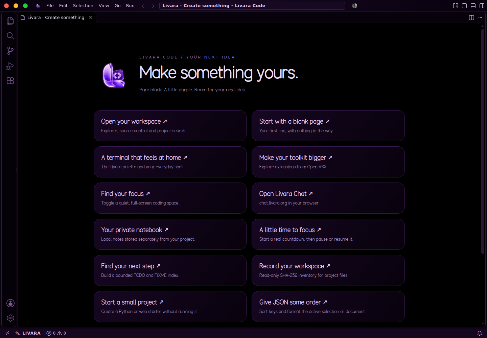

# Livara Code

Livara Code is an actual source fork of the MIT-licensed open-source editor workbench. The local builder downloads an immutable source commit, verifies its SHA-256, applies Livara's changes, compiles the workbench and built-in extensions, and packages the Electron desktop application. It does not relabel a downloaded editor binary.

The pinned source is release **1.143.1**, commit `e646868227c3e3a9e3f24277c8c7220be42c0be7`, with Node24.18.0 and Electron43.7.7. Pins and checksums live in `forks/code/upstream.json`. The full source and build dependencies are downloaded during the local build so they do not inflate the source ZIP.

## What Livara changes

- Independent Livara Code product identity, binary, protocol, Linux app ID, icon, settings folder, and server names.
- First-party visible workbench text uses Livara's name. Original licenses, notices and technical extension/API identifiers remain intact.
- An actual TypeScript workbench contribution, imported into the desktop entry point and compiled with the application.
- Original black and purple workbench chrome: activity rail, rounded tabs, command palette, notifications, menus and status bar.
- Livara AMOLED syntax theme with true `#000000` editor and terminal backgrounds, violet accents, and coordinated syntax colors.
- Livara file/folder/configuration/data/image icons, replacing the default file theme.
- Livara Sans for interface text and Livara Mono for editing and terminal text. Livara Persian preserves contextual Persian/Arabic shaping; Noto fonts cover additional writing systems. The six Livara font files are bundled and installed with the OS.
- A Livara welcome hub with working links to projects, commands, the terminal, extensions, notes, focus, TODOs, inventories, JSON tools and Chat.
- A dedicated Livara terminal profile, smooth scrolling, bracket guides, cursor motion and configurable workbench defaults.
- Product telemetry and experiments off, workspace trust on, and local settings/hot-exit support retained.
- Open VSX as the user extension source. Built-in debugger extensions retain pinned GitHub source downloads and original license metadata.
- The unrelated cloud AI extension build, account onboarding and AI status icon are disabled. The local account service still initializes correctly without an external provider. The Chat action opens `chat.livara.org` after a user click.

The upstream workbench's real explorer, tabs, language services, search, source control, diff editor, terminal, debugger UI, settings, keybindings and extension API remain available. Extension availability and licensing differ by registry; proprietary marketplace extensions are not bundled or promised.

## Twelve additional commands

Open the command palette and type **Livara**, or use the welcome hub.

| Command | Actual behavior |
| --- | --- |
| Private notes | Opens a local notebook in separate extension storage, with private directory/file permissions. |
| Start focus timer | Starts a validated 1–180 minute countdown in the status bar; notifies once on completion. |
| Pause or resume focus | Pauses the countdown and resumes its remaining duration. |
| Cancel focus timer | Stops the countdown and releases its recurring callback. |
| Workspace TODO index | Scans a bounded local workspace for TODO/FIXME markers and opens a report. |
| SHA-256 | Hashes selected text or explicitly chosen original file bytes. |
| Insert UUID | Inserts a cryptographically random UUID in the active editor. |
| Insert password | Inserts a cryptographically generated password without logging or copying it. |
| Sort and format JSON | Sorts keys and formats selected/current JSON, refusing unsafe precision loss. |
| Compare with clipboard | Opens a read-only diff of text and clipboard snapshots. |
| Workspace inventory | Computes bounded SHA-256 file inventories in an unsaved report; source files stay unchanged. |
| Create a project template | Exclusively creates a small selected starter template without overwriting or executing project code. |

Workspace scans skip symlinks, dependency/build folders and out-of-root paths, and enforce file/byte/depth limits. Commands that edit text require explicit invocation. Private notes are ordinary local files, not encryption or a backup service. Focus sessions do not survive application shutdown.

## Window controls

The custom title bar uses the actual desktop window buttons, with red close, yellow minimize and green full screen. Shift-click green maximizes/restores; F11 toggles full screen. The buttons have keyboard focus, accessible labels, Enter/Space actions, and pointer targets larger than the visible dots.

Find **Livara Window Controls** in the editor's Settings UI, or set these user preferences:

| Setting | Default | Choices |
| --- | --- | --- |
| `livara.windowControls.style` | `trafficlights` | `trafficlights`, `native` (standard workbench appearance) |
| `livara.windowControls.position` | `left` | `left`, `right` |
| `livara.windowControls.size` | `14` | 10–22 pixels |
| `livara.windowControls.symbols` | `hover` | `hover` (also keyboard focus), `always` |
| `livara.windowControls.greenAction` | `fullscreen` | `fullscreen`, `maximize` |
| `livara.windowControls.closeColor` | `#ff5f57` | A six-digit hex color |
| `livara.windowControls.minimizeColor` | `#febc2e` | A six-digit hex color |
| `livara.windowControls.maximizeColor` | `#28c840` | A six-digit hex color |

These eight preferences update immediately. Standard workbench appearance preserves the original maximize/restore action. OS-owned controls remain available with `window.controlsStyle: "native"`, or `window.titleBarStyle: "native"`; those upstream settings require a full application restart and follow the OS placement. Livara defaults both the title bar and its controls to `custom` so the traffic-light preferences apply. The compositor controls whole-window open/close animations; CSS transitions respect reduced-motion preferences.

## Build

The Windows full builder includes this build automatically. On an x86_64 Linux host with Docker:

```sh
bash scripts/build-code.sh
```

The resulting files appear in `dist/forks/`:

- `livara-code-linux-x64.tar.xz`
- `livara-code-linux-x64.tar.xz.sha256`
- `livara-code-build.json`

The archive contains one `livara-code/` folder, including the actual `livara-code` executable and `bin/livara-code` CLI. The final Docker stage is `artifact` and exposes the files under `/artifacts/`. The OS installer places the application under `/opt/livara-code`; the desktop launcher runs it with its normal sandbox. Compilation targets generic x86-64 rather than the build machine's CPU.

`bash scripts/build-code.sh --check` checks the local recipe and source pins without fetching dependencies or compiling. The full build needs internet access, several gigabytes of downloads, and substantial Docker disk space. Dependency and source caches remain local; no upstream account or marketplace credentials are required.

## Validation

Seven Python tests cover pinned inputs, independent product configuration, preservation of notices/API identifiers, actual source transformation, unknown-version rejection, theme/command entry points and restrictive webview CSP hashes. Twelve Node tests exercise real filesystem/crypto behavior and the extension command API, including private notes, local desktop user-data storage, focus completion/pause/disposal, scan boundaries, file hashes, generated secrets, JSON precision, read-only diff snapshots, inventory limits and exclusive project creation.

Three further Node24 tests check the eight window preferences, bounds and CSS-injection rejection. The standalone window controller passes strict TypeScript checking against the DOM types. Its complete TypeScript-emitted workbench contribution/controller and CSS were integrated into the already source-built application for real GUI testing with a window manager: green full screen, F11 exit, live position/size/colors/symbols, maximize/restore preference, Shift-click maximize/restore, keyboard full screen, minimize and close all passed. This did not repeat the entire workbench build; `forks/code/window-controls-qualification.json` records the precise hashes and checks.

The pinned workbench, built-in extensions and Electron Linux desktop package completed a real native build. GUI testing then found compatibility defects in upstream account onboarding and Livara's webview branding. The final source fixes preserve the injected onboarding service, resolve local account initialization without a cloud provider, and refresh inline-script SHA-256 hashes after branding. CSP stays restrictive.

These final source fixes were applied to the pinned source and checked with TypeScript transpilation and regression tests. The already compiled application received equivalent compatibility edits for runtime qualification; the entire final source revision was not compiled a second time. The standard builder applies all fixes before compiling and generates its package integrity checksums normally. Exact source and qualification hashes are recorded in `forks/code/qualification.json`.

The real, non-root Electron application passed visible workflow tests: welcome hub rendering, private notes creation with mode0600, UUID insertion and saving, Persian text paste and saving, focus start/pause/cancel, and a real bash terminal using Livara's terminal profile. The application sandbox stayed enabled. The main capture includes the subsequently qualified traffic lights; the notes and terminal captures show the earlier workflow test.



[Custom controls on the right](livara-code-controls-custom.png) · [Editor and Persian text](livara-code-notes.png) · [Integrated Livara terminal](livara-code-terminal.png)

This qualifies the editor application rather than a complete OS boot. This source-only OS revision does not include a newly built ISO.
