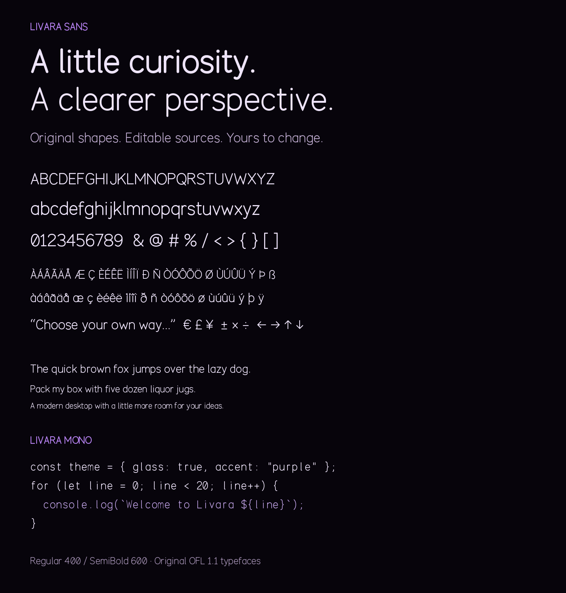

# Editable Livara fonts

Livara includes two original Latin font families and a separately attributed Persian/Arabic adaptation:

| Family | Purpose | Available faces |
| --- | --- | --- |
| **Livara Sans** | Desktop UI, browser chrome, headings, and body text | Regular400, SemiBold600 |
| **Livara Mono** | Code, terminals, and aligned developer text | Regular400, SemiBold600 |
| **Livara Persian** | Persian/Arabic text, based on Vazirmatn with its shaping retained | Regular400, SemiBold600 |

The design uses open rounded forms, a geometric single-storey `a` and `g`, real lowercase/ascender/descender proportions, slashed zero, and a distinct barred capital `I` in the coding face. Sans has proportional advances and explicit optical kerning pairs. Mono uses a fixed650-unit advance for every glyph.



Each original Sans/Mono face contains **204 encoded characters**: all printable ASCII, all Latin-1 characters from U+00A0 to U+00FF, the Euro sign, typographic quotes, en/em dashes, ellipsis, bullet, and four arrows. Each has205 glyphs including `.notdef`. Livara Persian separately contains811 encoded characters and1333 glyphs. Other languages and symbols use the installed Noto fallback families; the wider system font stack supplies Cyrillic, Greek, Hebrew, CJK, Indic, and other supported scripts. These fonts do not claim complete Unicode coverage, extensive OpenType shaping, a variable-weight axis, or a finished professional hinting/spacing qualification.

## Edit outlines directly

Open a source directory such as `fonts/sources/LivaraSans-Regular.ufo` in **FontForge** or another UFO-capable font editor. It contains ordinary UFO3 metadata and editable GLIF quadratic outline points. Change points, side bearings, advances, kerning, or metadata, save the UFO, and rebuild:

```sh
python3 scripts/build-fonts.py
```

This default command reads the existing UFOs and writes all six TTFs in `fonts/ttf/`. **It preserves your UFO edits and Persian TTX edits.** It does not regenerate shapes from the model. Modified glyphs and new glyphs listed by the UFO glyph set enter the rebuilt font; the existing glyph order is preserved and newly added glyphs are appended.

Install the build dependency on Ubuntu with `sudo apt install python3-fonttools`. The Windows source builder includes this dependency in its Linux controller and compiles edited UFOs before packaging. Its host does not need Python installed. For a graphical UFO editor, use FontForge. Regular and SemiBold UFOs are independent editable masters; edit both if a shape change should apply to both weights.

## Edit the geometric design

`fonts/sources/design.json` records the original centerline paths, cubic/quadratic curve controls, dot geometry, metrics, kerning, and global design parameters. Path coordinates use1000 units per em, baseline0, cap height720, and x-height510. The model's `stroke_regular`, `stroke_semibold`, `tracking`, and `mono_advance` values can change the family systematically.

To redraw all UFOs and rebuild after changing this model:

```sh
python3 scripts/build-fonts.py --regenerate
```

**`--regenerate` replaces the UFO outline sources.** Keep a copy of direct UFO edits before using it. The rounded stroked centerlines are expanded into original quadratic outline contours, with opposite winding around counters and explicitly marked overlaps. Latin accents and fraction forms are constructed from the same original letters/numerals. Mono has an additional original capital-I treatment for code readability.

SVG files in `fonts/sources/svg/` are editable visual counterparts to the base centerline model. SVG edits are not automatically imported: copy changed path data into the model or edit the corresponding UFO outline. The final TrueType source is the UFO, not a hidden installed upstream typeface.

## Install or embed

The font files are:

```text
fonts/ttf/LivaraSans-Regular.ttf
fonts/ttf/LivaraSans-SemiBold.ttf
fonts/ttf/LivaraMono-Regular.ttf
fonts/ttf/LivaraMono-SemiBold.ttf
fonts/ttf/LivaraPersian-Regular.ttf
fonts/ttf/LivaraPersian-SemiBold.ttf
```

Use the CSS family names `Livara Sans`, `Livara Mono`, and `Livara Persian`, with weight400 or600. A system installation places them in `/usr/share/fonts/truetype/livara/` and refreshes fontconfig. Application forks can embed these exact files using `@font-face`. Restart an open application after replacing installed font binaries.

The fonts and their editable design sources are **SIL OFL1.1** software, with no Reserved Font Names. The project's original build tooling retains the repository's code license; it does not change the fonts' OFL license. Keep `fonts/OFL.txt` with font redistribution. A document typeset with these fonts is not subject to the font license.

## Validation

Nine checks cover names, licenses, complete promised coverage, fixed/proportional metrics, distinct weight outlines, counter winding/accent descenders, reproducible UFO/TTX rebuilds, preservation of manual GLIF point/advance edits, pinned Vazirmatn sources, and actual HarfBuzz Persian contextual joining, Lam-Alef ligatures, ZWNJ boundaries, and GPOS mark positioning. The specimen was rendered with Pillow/FreeType and visually reviewed. Regenerate it with `python3 fonts/specimens/render.py` when Pillow is installed. Cross-platform small-size hinting, full multilingual shaping, print production, and accessibility typography remain future qualification work.

## Persian and Arabic


Livara Persian is a renamed **Vazirmatn33.003 derivative**, not an original geometric Latin font or a claim to invent Persian calligraphy. It retains Vazirmatn's glyph design and shaping from the official pinned source commit `83629f877e8f084cc07b47030b5d3a0ff06c76ec`. Its separate license/copyright and source manifest are in `fonts/vendor/vazirmatn/`; keep that OFL and attribution with Persian font redistribution.

The two editable derivative sources are `fonts/sources/LivaraPersian-Regular.ttx` and `LivaraPersian-SemiBold.ttx`. They contain the full TrueType table XML, including outlines, names, metrics, GSUB, GPOS, and GDEF. Edit them in a code/XML editor and run `python3 scripts/build-fonts.py` to compile them without replacing the edits. FontForge can also edit the resulting TTFs; export XML with `fonttools ttx` if you want its exported font to become a canonical TTX source.

Original official Thin/Regular/Black `.sfd` FontForge masters and the variable TTF are included under `fonts/vendor/vazirmatn/`. The original project's scripts are the reference for a full upstream master/interpolation build. Livara's normal build intentionally uses the full-table derivative TTX source so it keeps the tested Arabic/Persian shaping exactly.

To explicitly replace the two derivative XML sources from the verified official variable input, run `python3 scripts/build-fonts.py --prepare-persian`. This command overwrites Persian TTX edits; save a copy first. `--regenerate` redraws only the original Latin UFOs and leaves Persian TTX sources alone.

Persian Yeh/Kaf, contextual forms, right-to-left shaping, Lam-Alef, diacritics, and zero-width non-joiner boundaries are retained. `fonts/specimens/render-persian.py` renders the actual font with Pillow/RAQM. The tests use Python uharfbuzz or the `hb-shape` tool from `libharfbuzz-bin` to execute real shaping.

A broad Noto fallback stack complements these Livara families for scripts beyond their glyph sets. No single font or font stack is a guarantee for every Unicode character, historical script, shaping convention, or language; application shaping, bidirectional text handling, locale support, and input methods matter too.
