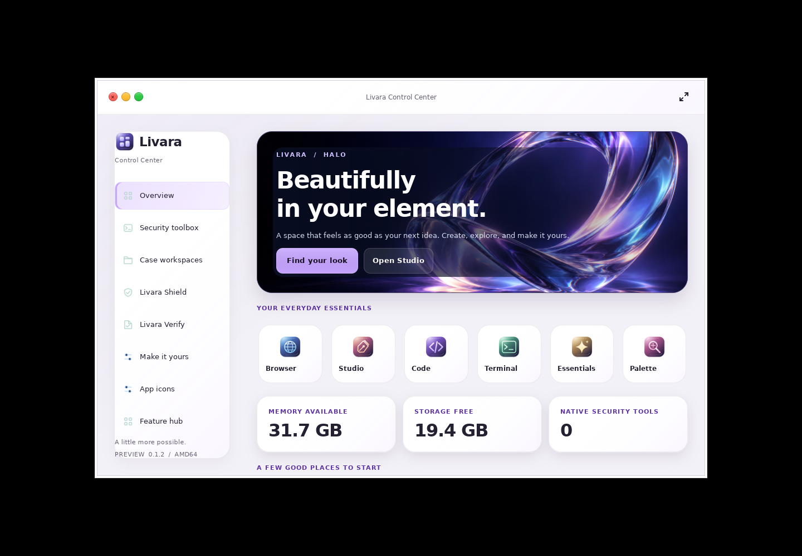
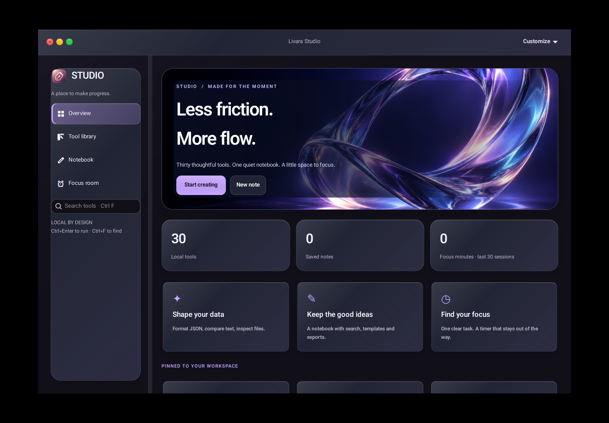
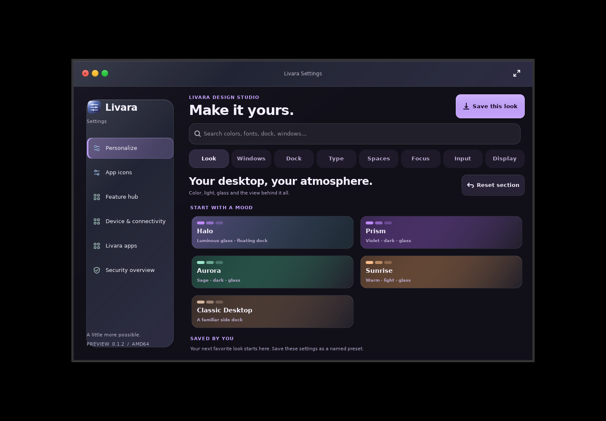
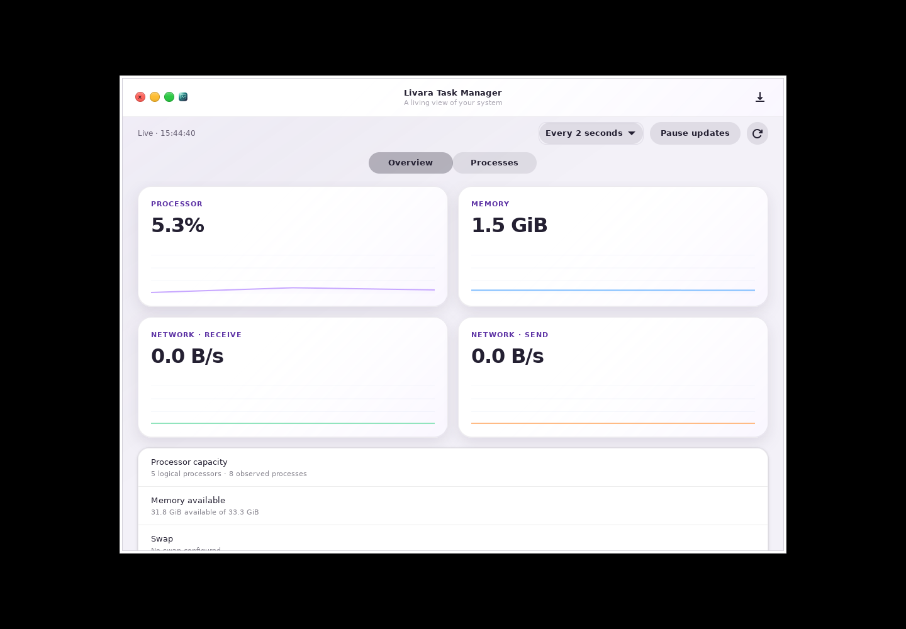

# Halo — Livara desktop 0.1.2

Halo brings an original glass-ribbon identity to Livara: a quiet ink canvas,
optical highlights, floating navigation, spacious workspaces and clear actions.
Center has a responsive six-app launch shelf and real system metrics. Studio
shares the artwork while retaining its tools, notes and focus workspace.

Native pages crossfade in 180 ms, respect reduced motion, and use finite hover
transitions. The artwork is a static texture. There are no looping shimmer
effects or background image-processing timers. Shell blur remains bounded and
releases hidden surfaces. This is a design and responsiveness update, not a
claim of measured performance gains on every GPU.

Choose **Settings → Personalize → Halo** to apply the new wallpaper and floating
dock preset. Existing saved wallpapers, looks and font preferences are retained.
The update also refreshes Browser and Code chrome and keeps readable solid and
high-contrast alternatives.

These are actual GTK window captures, with shipped fonts and artwork:

Install using the [desktop update instructions](updates.md). Download both
packages, SHA256SUMS and the installer into one folder. No ISO is needed.

The [release qualification](halo-qualification.json) records the immutable source,
public ZIP and package hashes, native checks and remaining test limits.
