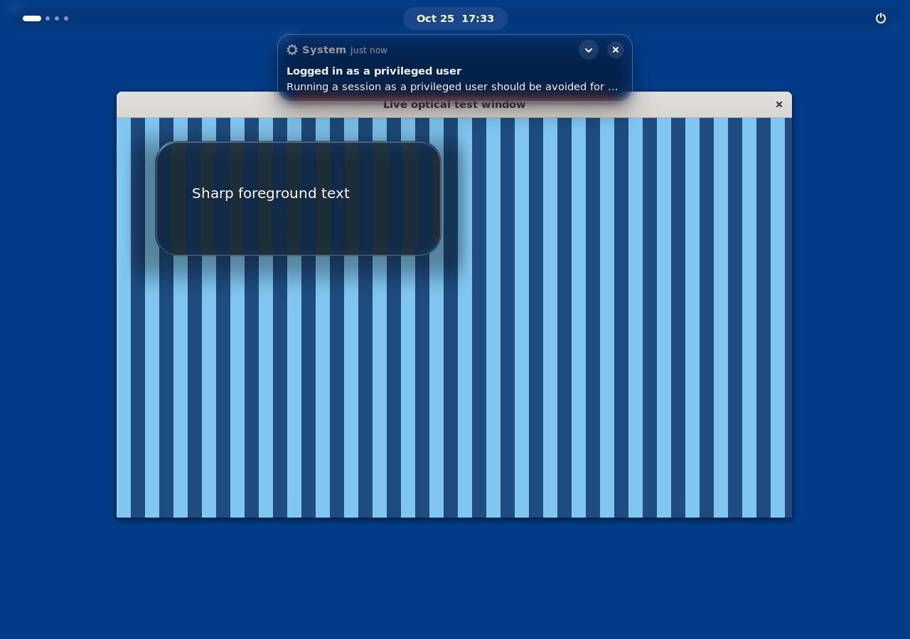
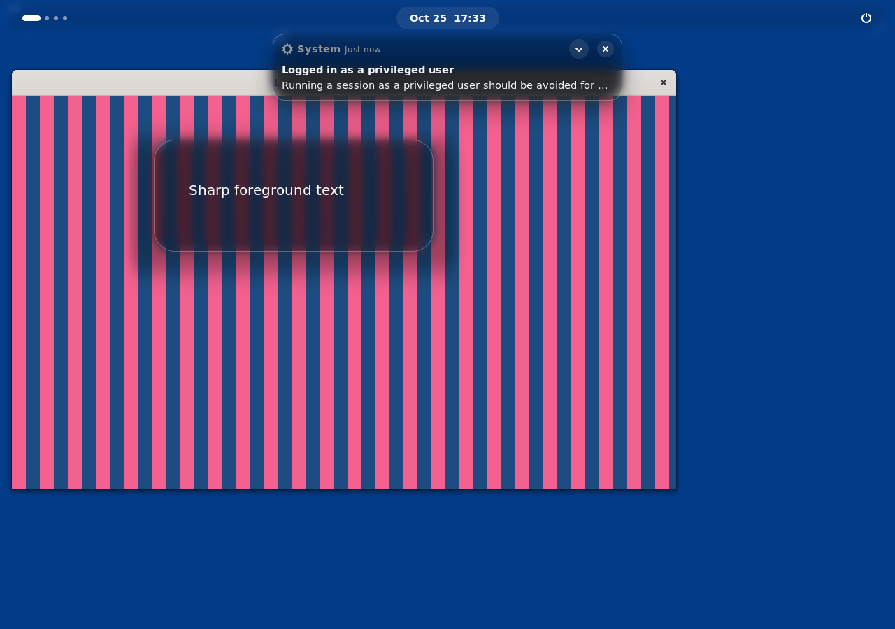

# Live Liquid Glass — desktop 0.1.3

Livara now refracts **live compositor pixels** on eligible shell panels, dock
backplates, menus, notifications, on-screen indicators and modal dialogs.
Curved edge normals displace background samples, with interior magnification,
subtle RGB dispersion, adaptive tint and pointer-oriented specular highlights.
Foreground text and icons stay in separate actors above the optical layer.

These are captures from a real GNOME 46 Wayland compositor with a native GTK4
striped window behind a shell popup. They are renderer output, not mockups.
The first two isolate refraction by turning softening off; the third restores it.

| Displacement disabled | Live refraction | Softened material after content update |
| --- | --- | --- |
|  |  |  |

The native renderer test measures 6,676 changed pixels when refraction is enabled,
41,166 after moving the underlying window and 31,170 after the application paints
new content. All 382 interior white glyph pixels stay at exactly the same
positions. Minimize/restore, hide, glass toggle, full extension disable/reenable,
Overview, high contrast, reduced motion and an eight-lens stress case pass.
[Machine-readable renderer results](liquid-glass-renderer.json).

The shader samples allocated Clutter clones of wallpaper and visible windows,
in compositor stacking order. It does not take screenshots, poll the screen or
run a per-frame JavaScript timer. A maximum of eight live lenses shares six
million device pixels; invalid, oversized, unsupported or excess surfaces keep
the previous blur/static-rim material. The clear style is applied only when a
live GPU backplate is attached. Glass off, high contrast, lock/greeter and
Overview release the live scenes. Reduced motion uses static lighting.

Native GTK application cards still use readable CSS backgrounds. This release
does not turn app windows into desktop-sampling lenses. Browser and Code retain
their existing chrome. This is Livara's original Linux implementation, not
Apple's proprietary renderer. GNOME 46 software rendering was tested; hardware
FPS, battery and thermal performance still need device qualification. The
isolated compositor emits transient allocation warnings during transitions,
but the test completes without GJS errors or critical diagnostics.

## Reproduce the compositor test

The test uses a disposable root container and its own session D-Bus. It must
never run inside your normal desktop session. Docker's normal sandbox is used.

```sh
docker build -f build/Dockerfile.glass-test -t livara-glass-validation .
mkdir -p .build/liquid-test
docker run --rm --init --network none -e LIVARA_DISPOSABLE_GLASS_TEST=1 \
  --mount "type=bind,src=$PWD,dst=/project" \
  --mount "type=bind,src=$PWD/.build/liquid-test,dst=/out" \
  livara-glass-validation
```

The harness loads the production extension, starts a real GTK Wayland client,
captures flat/refracted/live/content-updated states, checks cleanup and resource
limits, and verifies foreground glyph masks. `verified.json` and the PNG files
remain in the output directory. Screenshot APIs exist only in this test probe.

Install the [incremental update](updates.md), then log out and back in to load
the new shell renderer. No ISO download is required.
