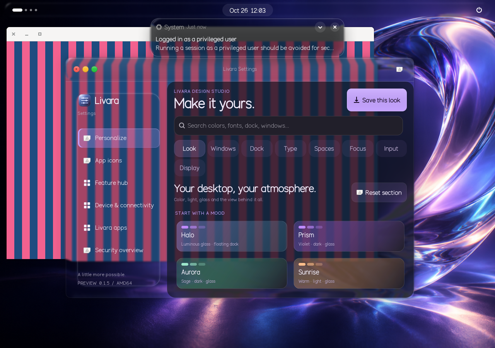
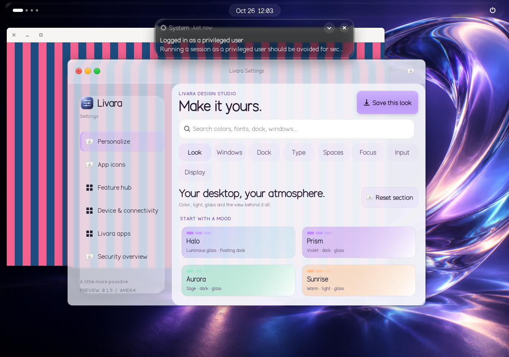

# Native Liquid Glass and desktop audit — 0.1.5

The previous release refracted shell furniture, while native Livara apps still
used flat CSS backgrounds. This update puts an actual live compositor scene
behind the focused native app. Its window edge, header and sidebar bend the
pixels behind them, with bounded dispersion and directional highlights.
Foreground text, controls and icons remain in the original GTK window.

The stripes are a deliberately demanding live test window, not wallpaper or an
image inserted into the app. Their edges bend around the header, sidebar and
outer bevel. The readable content canvas uses a denser tint. This capture comes
from the actual desktop DEB in GNOME 46's Wayland compositor, rendered by Mesa
software rendering in a disposable container.

## Scope and fallback

The native bridge covers Center, Settings, Studio, Monitor, Graphics, Essentials,
Palette and Chat. Only the focused window receives a native lens, keeping the
rendering cost bounded. Each preview/window has its own GTK D-Bus identity.
The app clears its chrome only after the compositor confirms its live plane.
Switching focus, disabling glass, high contrast or losing the renderer restores
the opaque material. Browser and Code keep their existing application chrome;
this does not add desktop sampling to those engines or third-party windows.

Geometry follows real header/sidebar allocations. The host verifies that the
D-Bus caller owns the target window, accepts at most two finite bounded regions,
and samples only visible current-workspace windows below that window. It does
not capture the app's own text. There is no CPU screen capture, screenshot-based
production glass or per-frame Python polling.

## Checks performed

The [raw installed-package result](native-liquid-verified.json) records two live
sources and two independently curved chrome regions. `test-native-liquid.sh`
unpacks the actual release DEB, loads its installed extension and Python app,
and verifies in a real Wayland compositor:

- Flat to refracted: 159,946 changed pixels; moving the background: 296,987;
  changing its content: 285,451. Each comparison requires more than 2,000.
- All 907 bright foreground glyph pixels remain unchanged in all four captures.
- Main/preview window focus isolation, light appearance, high contrast, glass
  off/on, extension disable/enable and opaque fallback all pass.
- No Gjs/Clutter/GLib-GObject/libmutter criticals or JavaScript errors.

The release workflow repeats this check against its newly built DEB and retains
screenshots, the compositor log and pixel reports as `native-liquid-runtime`.
It also checks shell refraction and the pinned compiled Browser in Wayland.

The desktop audit additionally exercised:

- Settings: all 94 controls across eight categories, dependency transitions,
  numeric/font/color/wallpaper editing, saved-look creation/rename/delete,
  section resets, full-screen preview and all categories at 800×600.
- Native window controls: 26 interaction checks.
- Center: navigation, an actual Create case action and two preset applications.
- Studio: home, tools, notes and focus navigation.
- Essentials: native routes and theme editing; Palette: real search and bounded
  local file discovery; Monitor and Graphics: rendering and opaque fallback.
- Source suite: 266 Python tests (one optional pinned-Zen-source check skipped), plus Code
  feature/window-control and shell desktop-tool tests.

The audit found and fixed a stale-theme bug: removing an icon or sound theme
left its name in dconf, and applying an unrelated accent tried to reapply the
missing theme. Snapshots now omit unavailable themes. Explicitly importing an
unavailable theme still fails before any settings are written. Settings cleanup
also ignores queued refreshes after its window has been disposed.

This is not a claim that every OS bug has been eliminated. Native visual
qualification uses Settings as the representative full compositor client; other
native apps share the same window-style bridge. Chat's WebKit sandbox and GPU,
HiDPI, battery and multi-monitor behavior still need qualification on real
hardware. Container rendering is functional evidence, not an FPS benchmark.
Transient Mutter allocation warnings during scene changes remain in the logs.

## Install

Use the complete [0.1.5 update ZIP](https://github.com/Livara-Dev/Livara-OS/releases/tag/desktop-v0.1.5),
extract it, close Livara apps and run `bash Install-Livara-Update.sh` inside the
extracted folder. Log out and back in to load the updated compositor extension.
The update preserves user settings and profiles and does not rebuild/download
an ISO. See [update and recovery instructions](updates.md).
