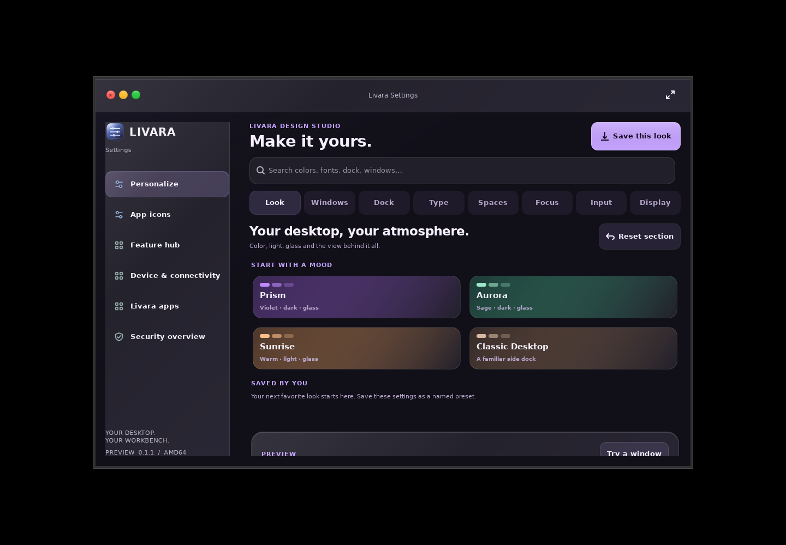
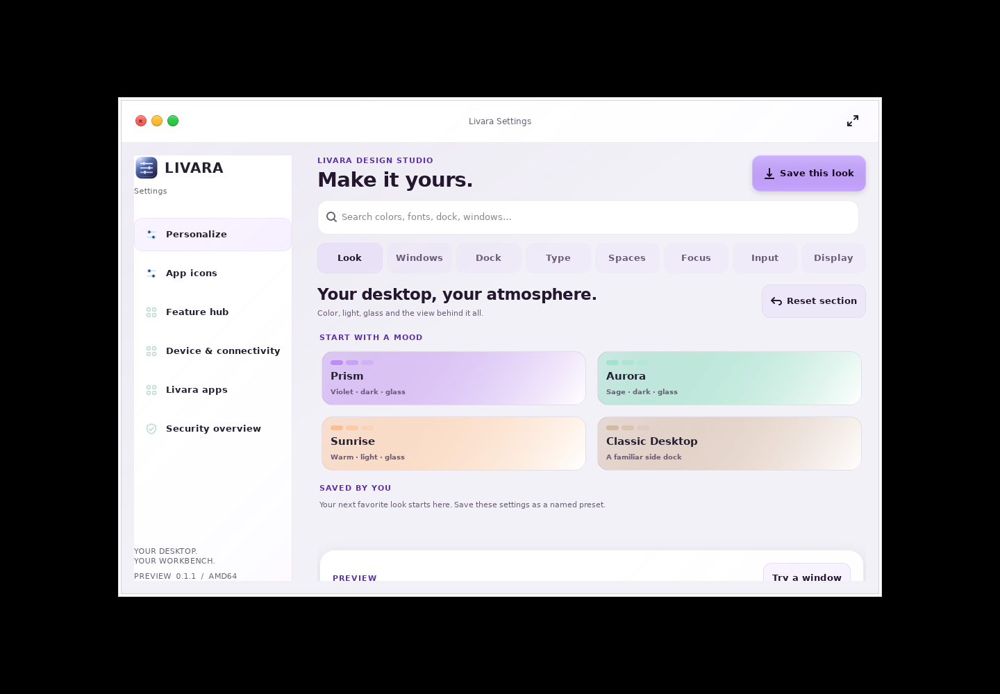
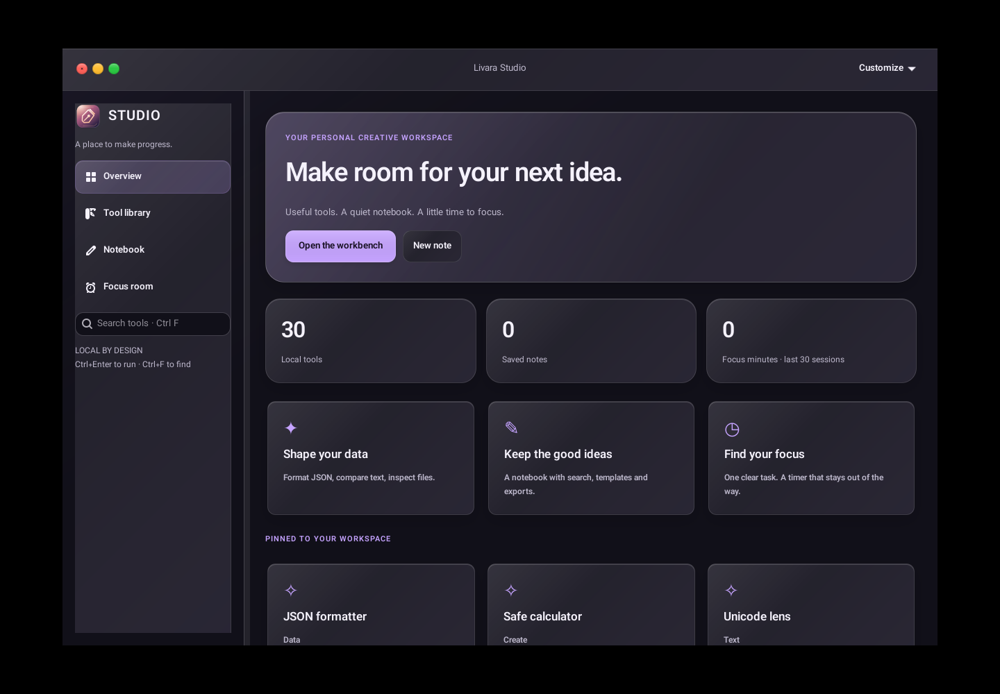
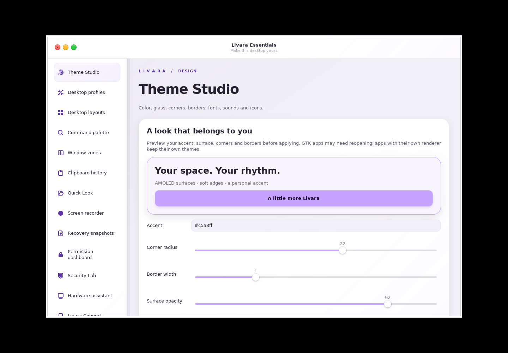
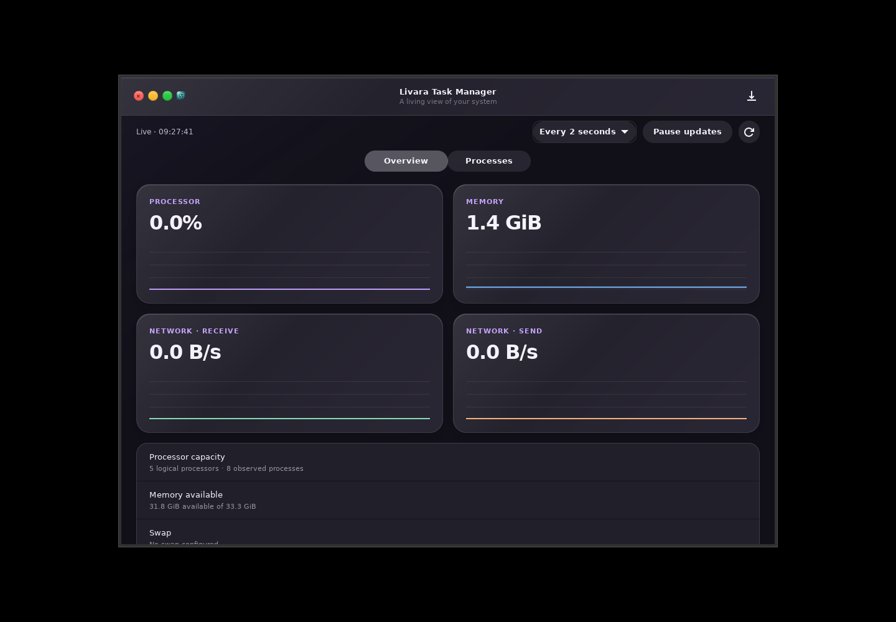
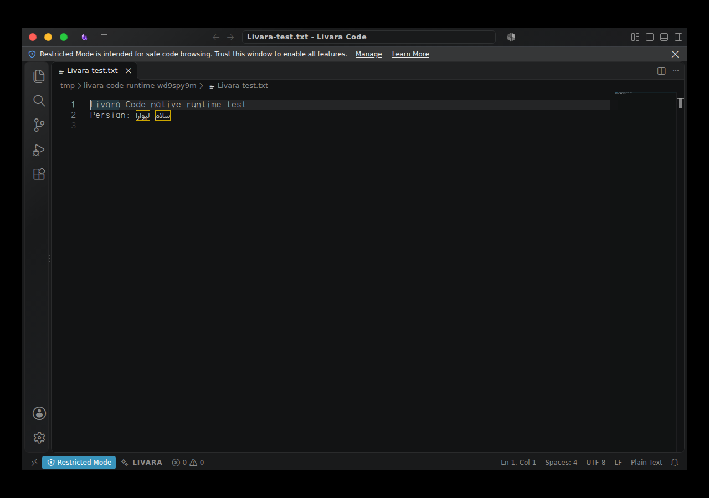
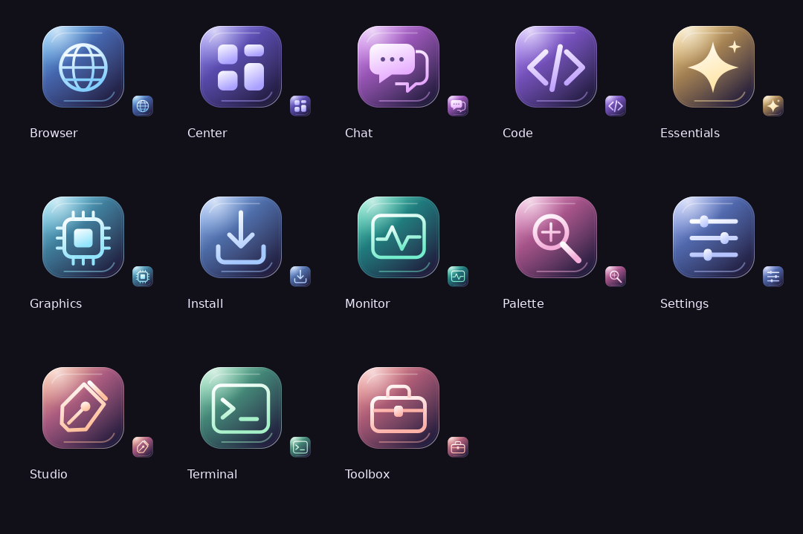

# Native application design

Livara's native applications share the material system in
`src/livara/materials.py`. Center, Settings, Task Manager, Studio, Essentials,
Graphics, Palette and Chat install it through their common headerbar setup.
The same provider observes desktop appearance, accent, glass and animation
preferences, so an open application changes with Settings without restarting.
Studio retains its explicitly saved local accent.

The base window and content surfaces stay opaque for legibility. Glass mode
adds a restrained tint, directional highlight, a lit top edge and a soft shadow
to raised surfaces; solid mode removes those decorations. These GTK materials
do not implement optical backdrop refraction. GNOME Shell manages compositor
blur on supported shell surfaces separately. The reduced-motion preference
removes material transition durations.

Use the shared classes for page titles, muted descriptions, cards, primary
actions and navigation. Keep text content on a stable surface and reserve
emphasis for the current selection or primary action. Avoid per-application
forced dark mode, whole-window opacity and fixed light text on a light card.
Theme Studio's user overrides and live previews have a higher provider priority
than the common application material.

`tests/test_materials.py` covers appearance propagation, reduced motion, solid
mode, local accent preservation and CSS value validation. Actual GTK rendering
must also be checked: a source-only test cannot detect a rejected CSS property
or an overflowing layout.

## Desktop update captures

These are actual GTK renders from the update source with shipped fonts and
icons, captured under Xvfb. They show native application rendering rather than
a running GNOME desktop or a booted ISO.

The [desktop update qualification](desktop-update-qualification.json) records
the exact released source, successful hosted build, real runtime checks,
published package hashes and remaining test limits.
